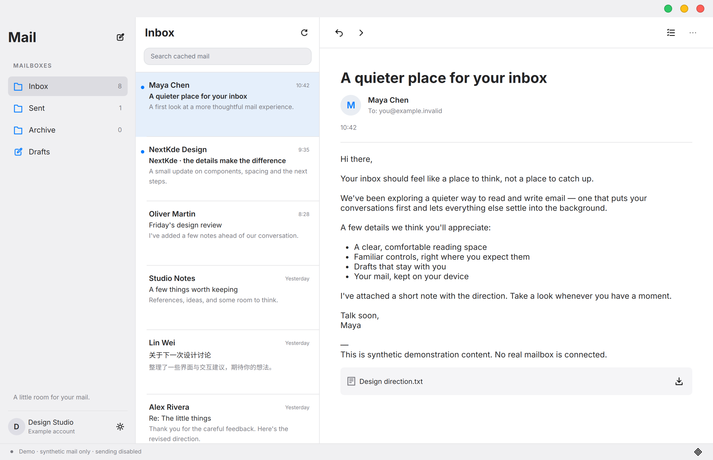
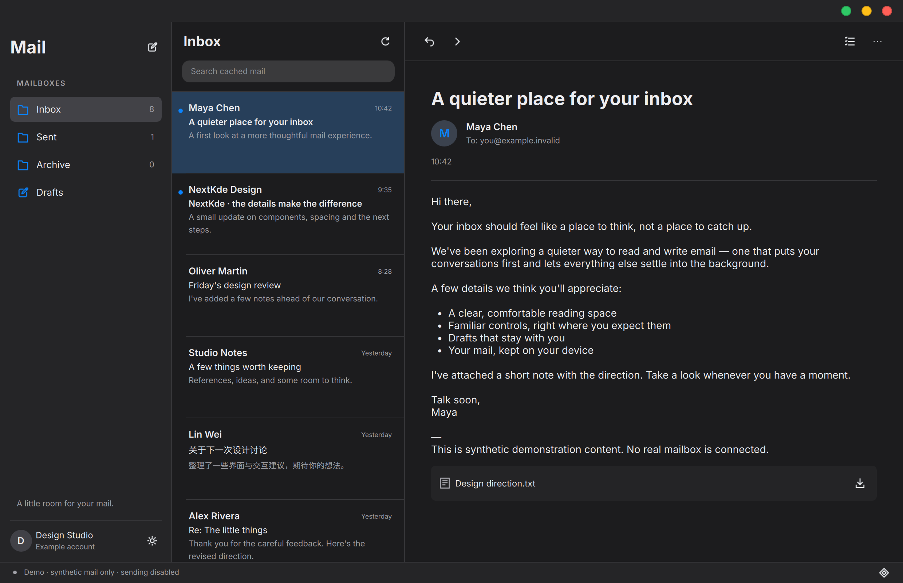
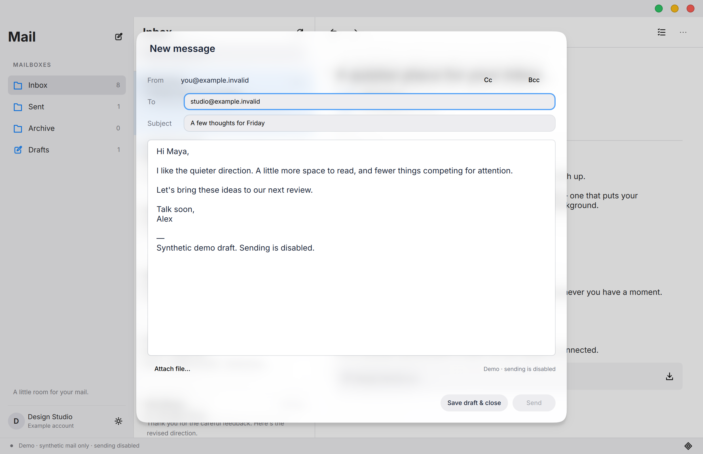
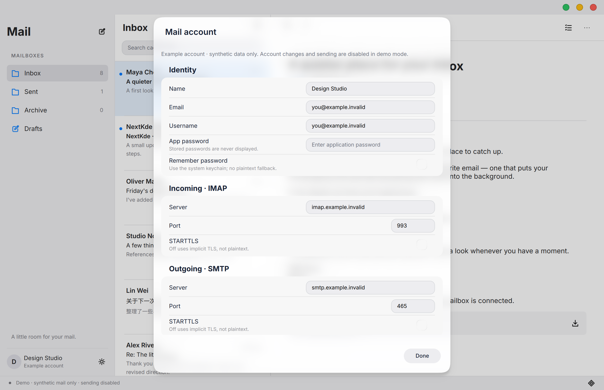
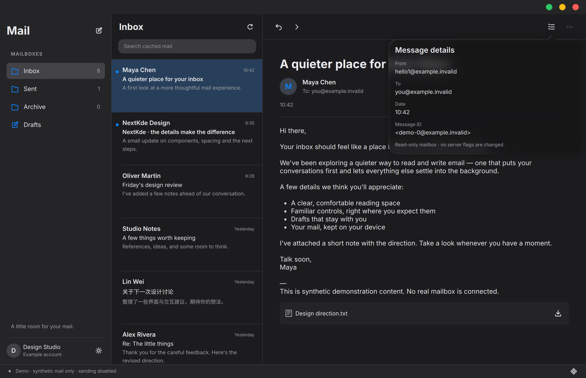
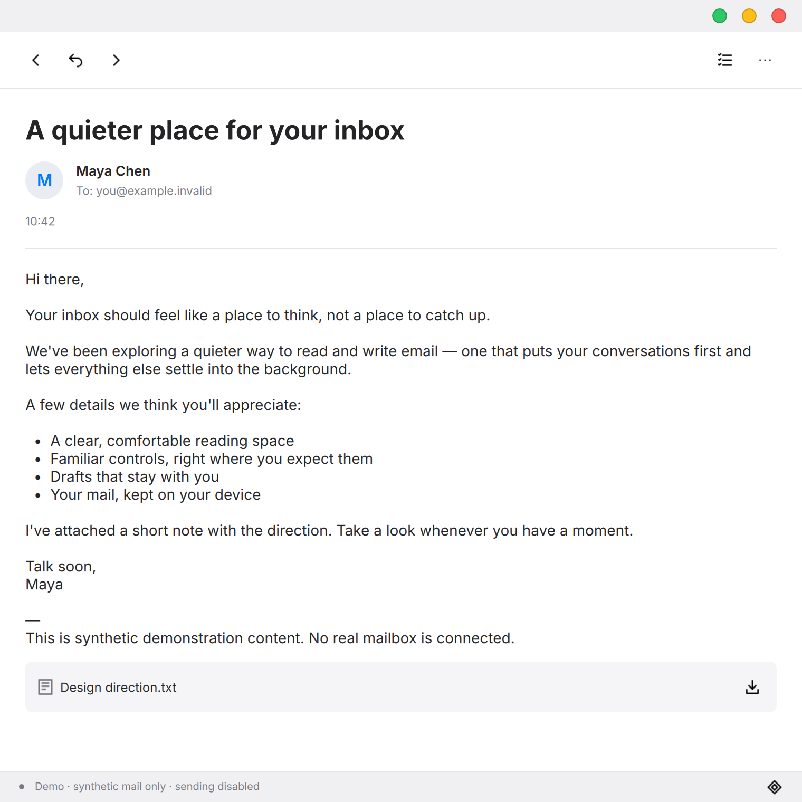

# 2026-10-29 · 首个可运行里程碑

## 已实现

这不是静态设计稿：截图来自本机实际运行的 NkMail，通过应用自己的窗口截图功能导出。公开截图统一使用 `.invalid` 合成邮箱；demo 模式不连接网络、不读取已有账号，且禁止发送。

- Qt Quick 三栏工作区、浅色/深色、窄窗阅读返回、右侧窗控。
- 直接构建 canonical Kos.Ui；账户对话框、写信对话框和详情 popover 不复制组件库实现。
- mailio 负责 IMAP、SMTP、MIME；补丁加入证书/主机名校验、SNI、TLS 最低版本、有限 I/O 超时、PEEK 与 literal 大小限制。
- IMAP 只读文件夹与头部分页，正文和附件按需获取；UIDVALIDITY + UID 身份隔离。
- SQLite 本地缓存、明确标注的缓存内搜索、自动保存/重启恢复草稿。
- 新建/回复/全部回复/转发、To/Cc/Bcc、附件添加/另存为。
- SMTP 接受/拒绝/结果不确定状态。发送前持久化草稿；不确定结果禁止自动重发，接受不代表最终送达。
- QtKeychain 无明文降级；密码不回填、不写 SQLite。缓存本身未加密，需要保护本地目录。

## 实际验证

最终集成执行：

```sh
cmake -S . -B build -G Ninja -DCMAKE_BUILD_TYPE=Debug -DNKMAIL_BUILD_TESTS=ON
cmake --build build --parallel 4
ctest --test-dir build --output-on-failure
```

结果：**3/3 CTest 通过，20.46 秒**。

- 核心 QtTest：16 passed / 0 failed（含初始化与清理）；迁移、离线缓存、草稿状态 CAS、崩溃恢复、UIDVALIDITY、账号隔离和增量模型。
- UI QuickTest：9 passed / 0 failed（含初始化与清理）；纯文本、防止 demo 发信、保存失败保留、匹配发送状态、窄窗、密码不回填、禁止真实模式 review。
- 协议夹具：30 个 loopback 场景；真实 mailio IMAP/SMTP，隐式 TLS 和 STARTTLS，错误主机名/过期/不受信证书认证前拒绝，PEEK、UIDVALIDITY、多语言 MIME、附件、Bcc 保密、SMTP 拒绝和断线不确定结果。
- 六个真实 GPU 窗口场景已经人工看图。存在上游 C++ 编译警告和 QML 输出目录的 CMake 工具提示；不能称为零警告构建。

## 仍未完成 / 限制

- **真实服务商兼容性待验证；未向真实收件人发送邮件。** 本地协议测试不能替代这一项。
- 未实现列宽拖动与窗口几何记忆，后续迭代处理。
- 首版不实现远程已读/星标修改、移动、删除、OAuth、多账号、IDLE、富文本编辑或后台守护。
- 未将发送成功的邮件 APPEND 到服务器 Sent 文件夹；本地状态记录与服务端归档不是一回事。
- Kos.Ui 来自外部 canonical 工作区，包含预先存在的组件更新；README 记录的 base SHA 本身不足以重现这一组件状态。
- I/O 超时为每次操作 15 秒，不是整个文件夹同步的总时限；文件夹统计仍有逐文件夹往返成本。
- MIME 树上限在 mailio 解析后检查，不表示完成了上游恶意 MIME 解析器全面审计。

## 截图

### 浅色收件箱


### 深色收件箱


### 写信与自动保存草稿


### 手动账户设置


### 邮件详情 popover


### 窄窗阅读


## 下一步

受控只读服务商验证、控制器工作流回归、分页与刷新边界检查，以及窗口/列宽体验完善。公开进展始终只使用合成数据。
