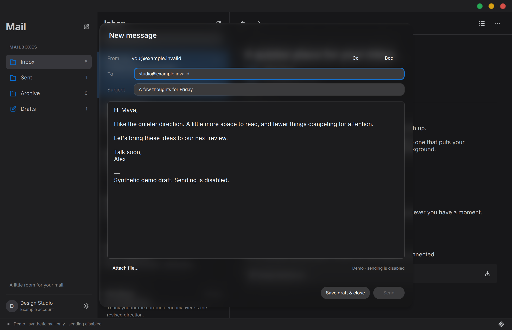
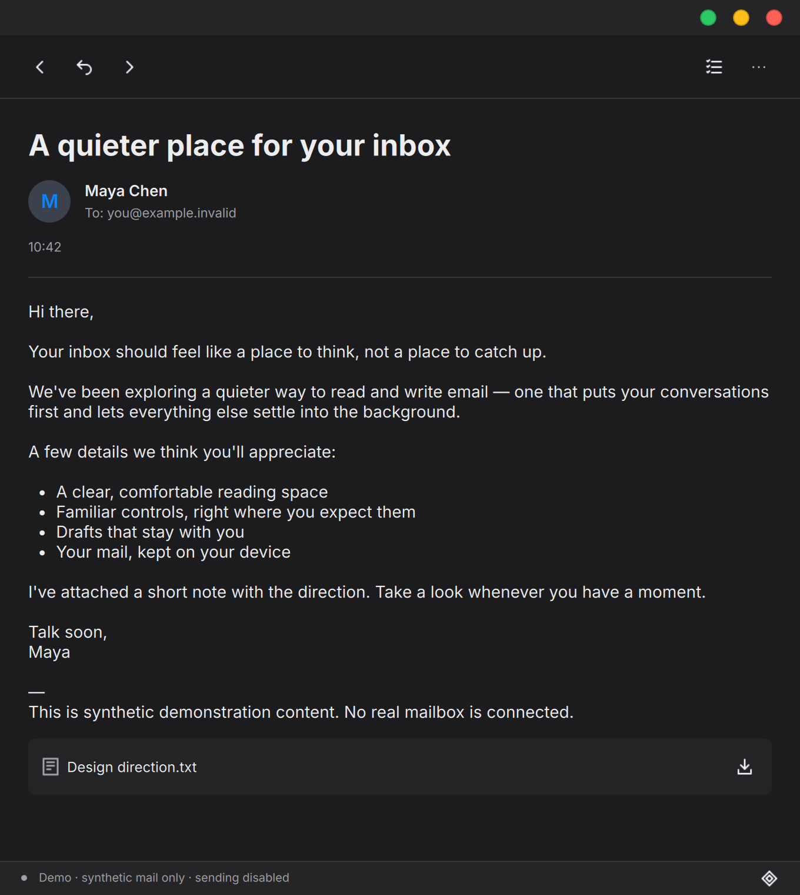

# 2026-10-29 · 第二轮：工作流回归与窗口体验

本轮继续使用合成数据；公开图片不包含真实账号、邮件或凭据。

## 功能与修复

- 两条栏分隔线可拖动，支持 Tab 聚焦后左右键调宽、双击复位；窄窗保留偏好而不挤压正文。
- 窗口正常几何、最大化状态与列宽保存到当前数据目录的 `window.ini`；恢复时限制到可见屏幕。demo 的偏好仅在临时目录，截图模式完全跳过偏好读写。
- 新增真实控制器集成测试，而不是仅依赖 QML mock。复现失败后修复：
  - 离线刷新失败后仍能完整翻页读取已有缓存。
  - 翻页遇到 UIDVALIDITY 变化时重新从第一页获取，不混合新旧代次。
  - 选择未缓存邮件时清空上一封正文/附件，不能误导出旧附件。
  - 修改 IMAP 传输身份时同步清空可见缓存，避免数据库已清而 UI 留旧数据。
- 钥匙环条目按 canonical 数据目录 + 账户 ID 隔离，不再让不同 `--data-dir` 共用 `default`。不会自动探测或迁移旧的全局条目；早期版本用户需重新输入密码一次。
- 自动回复/全部回复不再简单按逗号拆分或用子串排除自己：支持带引号的显示名、精确地址去重和自地址排除。复杂 group/comments/quoted-local 等语法明确拒绝自动生成并提示手动新建，不静默丢收件人；手动写信仍由 mailio 最终解析。
- 覆盖新建/回复/全部回复/转发、主题与引用、附件复制/另存为不覆盖、草稿丢弃和重启恢复。
- 新增 CLI 进程测试：非 demo 不允许截图；demo 不触碰指定的真实数据目录；同目录只允许一个实例，目录/数据库权限检查。

## 验证

详细测试边界见 [Testing](../../TESTING.md)。干净 Release 配置、构建与 **5/5 CTest** 已实际通过（27.48 秒）；不能将仅控制器替身的测试称为服务商集成成功。

中间一次 Debug 集成复跑发现拖动测试失败（actual 289 / expected 276）：测试向正在移动的 divider 注入局部坐标，受布局 polish 时序影响导致坐标叠加。已改为向固定 scene 注入拖动，保持严格 276 断言并增加反向拖回；连续三轮 UI 14/14 通过。没有以放宽断言掩盖失败。修复后最终 Debug 集成 **5/5 CTest 通过，27.96 秒**（含新增 32 个协议场景）。发布提交 `d5d5b7d` 的最终 Release 复核同样 **5/5 通过，27.92 秒**；上游 C++ 弃用警告仍存在。

- 核心：16 QtTest pass（含 init/cleanup）。
- 控制器：23 QtTest pass（21 个业务用例 + init/cleanup），无网络/钥匙环访问。
- UI：14 QuickTest pass（含 init/cleanup），包括实际分隔线拖动。
- CLI：3 个实际进程用例通过。
- 协议：32 个真实 mailio loopback 场景通过；新增逗号/双引号/反斜杠显示名的地址元数据往返验证，覆盖隐式 TLS 和 STARTTLS。后端 DTO 重组正确引用并转义显示名，本轮未改 mailio 依赖。

## 真实服务商状态

一次受控只读检查未完成邮件头/正文读取，未尝试备用密码。独立的无登录检查确认 TLS 证书/主机名和 IMAP 欢迎响应正常，但后端固定错误不能准确定位剩余失败阶段，因此不推断为密码错误。没有外部发信、没有修改邮箱。真实服务商兼容性仍是未通过的验收项，不能称完整可用首版。

## 新截图

### 深色写信

### 680px 深色窄窗阅读

完整三栏/账户/详情图片保留在[第一轮](../2026-10-29-first-runnable/README.md)，不覆盖历史截图。

## 保留限制

外部 Kos.Ui 工作区含预先存在的更新，base SHA 本身不能重现组件状态；复杂地址自动回复需要手动处理；没有服务端 Sent APPEND；没有 flags/move/delete/OAuth/多账户/IDLE。独立的额外安全审查未完成，不将其算作通过。当前 TLS/PEEK 的依据是已有代码检查与明确记录的协议回归，不是完整上游解析器审计。
