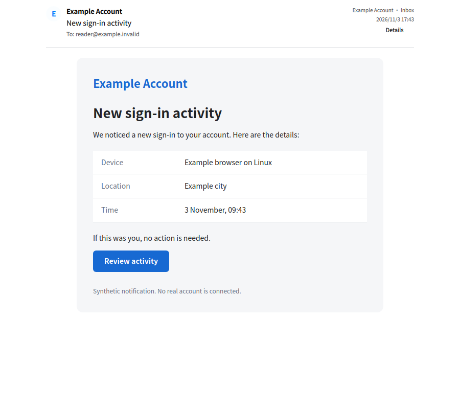

# Browser-based mail reader · 2026-11-03

The previous reader flattened email tables and discarded CSS before Qt rich-text rendering. Removing broken-image icons and spacer artifacts could improve readability but could not restore a sender's design. HTML mail now uses Qt WebEngine Quick. A separate browser-only sanitized representation retains tables, embedded CSS and layout attributes. The original simplified HTML remains the reply/forward representation and offline fallback.

## Isolation and data handling

- Each view has an off-the-record profile with no persistent cache/cookies, and rejects cookies. Its request interceptor permits only the current in-memory document scheme and inline data images, never HTTP, file, qrc, blob or subframes.
- A trusted document envelope supplies CSP: scripts, external resources, frames, objects, forms and base URLs are blocked. Mail scripts, local storage, plugins, PDF/media permissions, downloads and automatic navigation are disabled. Link activation keeps the existing copy-to-clipboard behavior.
- Application-owned code measures layout in an isolated JavaScript world; no WebChannel/host object is exposed. Chromium's process sandbox stays enabled. Browser tests run as an ordinary user with an Xvfb OpenGL/Mesa surface; CI now uses a non-root test user rather than disabling the sandbox.
- An opaque-origin, current-document-only memory scheme avoids `loadHtml`'s percent-encoded size limit. No real mail is written to temporary browser HTML files or served through a TCP listener.
- Remote images still use the explicit bounded QtNetwork loader. Browser-format image replacement preserves sender dimensions and styles. Image caches remain account/identity/format scoped.
- `displayHtml` and `bodyFormatVersion` are backward-compatible JSON cache fields. Selecting an older cached message keeps the fallback visible while re-reading that body once through the existing IMAP PEEK path. Offline profiles offer reconnection to recover formatting. No mail flags or content are changed by this read.
- Plain and legacy rich-text fallback widgets now have fixed formats. This avoids transiently interpreting literal plain text as markup while switching modes. Width-dependent legacy image fitting is deferred until layout settles.

## Validation

VM default pinned Kos.Ui source build succeeded (Qt 6.10.2). Final browser/UI checks passed 2/2 in 42.35s: 6 browser and 50 UI QtTest cases including init/cleanup. Core, controller, CLI, tray, i18n, catalog and loopback protocol suites passed in the staged regression runs; controller includes 37 passing cases and checks one-time cache upgrade plus preservation of downloaded-image CSS/dimensions.

Browser checks cover computed CSS padding/type size, table rows, narrow reflow, actual reader embedding/height, plain-text switching, a 300,000-character document beyond the encoded `loadHtml` limit, inline image decode, disabled page-script execution and zero observed loopback connections for image/background/navigation attempts. Initial navigation/API and test-visibility failures were resolved; strict general UI warning checks pass after separating fallback text modes and removing a layout/text binding loop.

Expected diagnostics remain: Qt 6.9+ warns about the compatibility profile constructor, blocked attack fixtures report CSP/local-resource denials, and existing compiler warnings remain. No warning filter or Chromium sandbox bypass was added. Hosted release-gate status is tracked on the PR; no merge is performed by this iteration.

`notification.png` is the actual integrated MessageReader captured in the VM with synthetic `.invalid` account data and an authored notification template. It demonstrates browser-rendered CSS/table layout; it is not the user's email or a full-window liquid-material acceptance image. The user's screenshot, credentials and mail were not published. Host compilation/relaunch is for the user's requested manual inspection; automated tests remain VM-only.

External fonts, CSS background resources, active content and CID image resolution are not enabled by this change. Sender styles are retained within the allowed passive HTML subset; unsupported markup is still removed.

API references: [Qt WebEngine settings](https://doc.qt.io/qt-6.10/qml-qtwebengine-webenginesettings.html), [request interception](https://doc.qt.io/qt-6.10/qwebengineurlrequestinterceptor.html), [custom document schemes](https://doc.qt.io/qt-6.10/qwebengineurlschemehandler.html).

Hosted `release-gate` passed for browser-reader commit `5dc43594f72f16713a98681e5583426c25cca7fa` on 2026-11-03 (run 41640362986). Later provider-guidance edits have their own check run.
