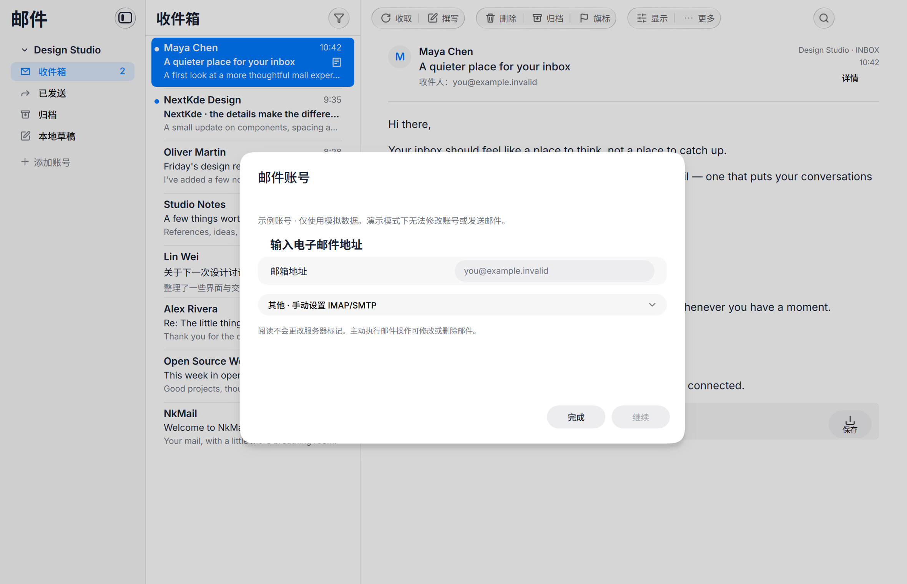

# 已确认第一阶段交付清单

| 范围 | 已交付 | PR |
|---|---|---|
| 邮件列表与菜单 | 可选本地首字头像、分组回复/全部回复/转发、单封/多选目标校验 | [#9](https://github.com/NextKde/NkMail/pull/9)、[#10](https://github.com/NextKde/NkMail/pull/10) |
| 添加账户 | 邮箱 → iCloud预设或手动 → IMAP/SMTP验证 → 完成；折叠高级配置、失败保留非敏感输入、重复提交保护 | [#11](https://github.com/NextKde/NkMail/pull/11)及其后续重试修复 |
| 左侧导航 | 统一行组件、跨账户缓存计数、服务器文件夹角色与排序、本地/服务器草稿区分、同步/错误状态按需显示 | [#12](https://github.com/NextKde/NkMail/pull/12) |
| 邮件详情 | 去除顶部详情按钮、紧凑邮件头与内联详情、长文本和窄窗口、主动加载图片等比适应正文 | [#8](https://github.com/NextKde/NkMail/pull/8)、[#13](https://github.com/NextKde/NkMail/pull/13) |

本机完整测试 8/8（43.20s），最后的账户保存拒绝/重试修复 UI 测试通过（9.84s）；共享 UI 固定依赖检查与 32 项 guard 测试通过。各功能 PR 有合成截图。基础 PR #7 的远程 release-gate 已通过；功能 PR 采用依赖堆叠，尚未合并，不能将本机测试等同于所有 PR 的远程验收。

验证仅使用合成邮箱和 loopback，未连接真实提供商。当前预设仅 iCloud，其他邮箱使用手动 IMAP/SMTP；不声称 OAuth/Exchange 能力。后续阶段的聚合收件箱、复制/附件转发、彩色旗标、提醒和规则不在本轮已确认交付表内。

最后补充的保存拒绝修复不改变布局。以下为当前添加账户入口，失败/重试状态由 UI 回归覆盖：

