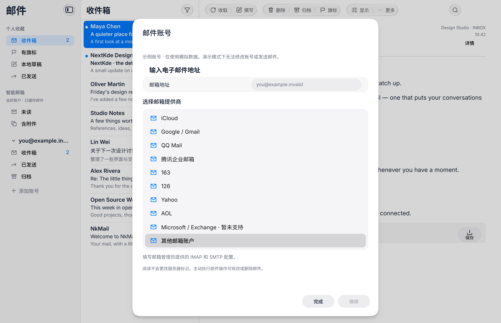

# Provider presets · 2026-11-03

The account wizard now offers iCloud, Gmail, QQ, Tencent Exmail, 163, 126, Yahoo, AOL and manual IMAP/SMTP. Selecting a provider fills TLS server settings and explains application-password requirements. Unknown custom domains are not guessed. Microsoft/Exchange is explicitly unavailable until its authentication path is implemented.

ProviderPicker and ProviderProfiles own presentation and presets. AccountSetup and the existing mail services still own verification, receiving and sending. Protocol changes add advertised IMAP ID negotiation, special-use Sent/All recognition and an account option to avoid duplicate sent copies when the server saves them (default for the Gmail preset).

This is a synthetic host Wayland capture; no personal mail or credentials are included. Shared Kos.Ui source/materials are unchanged. Compositor-owned window buttons are outside application captures.

Validation: full CTest suite, including UI, translations, controller and 44 synthetic loopback protocol/TLS scenarios; dependency gate and 32 dependency regressions. Results are recorded in GOAL.md after execution. No live provider account was tested and no real message was sent. OAuth, token refresh and native Exchange remain unimplemented. See [provider scope and sources](../../PROVIDERS.md).
