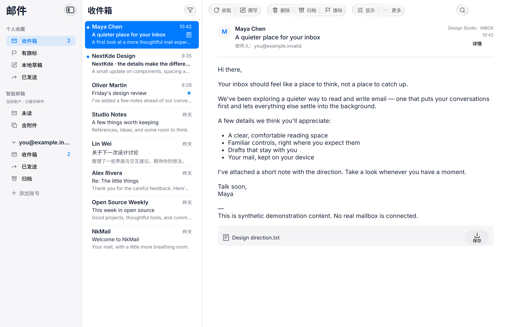
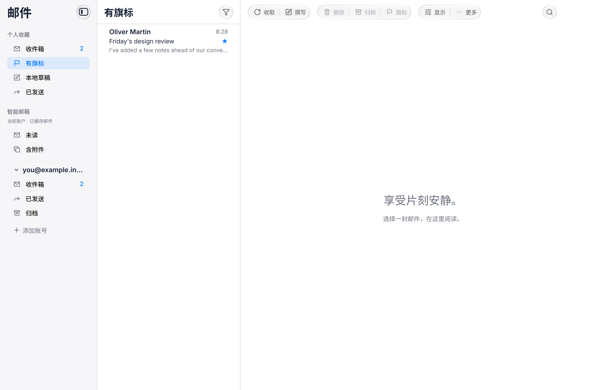

# 补齐参考图的左侧导航层级

此前只完成账户文件夹、计数与角色，不能称为完整达到参考图。此次补齐：

- 个人收藏默认展示收件箱、有旗标、本地草稿、已发送；保留用户固定的文件夹。
- 智能邮箱展示未读和含附件；账户文件夹保留展开、折叠与原有管理功能。
- 账户标题使用邮箱地址。收藏与账户中的同一文件夹只高亮当前入口。
- 有旗标/未读/含附件查询当前账户全部已缓存文件夹，保留源文件夹、UIDVALIDITY、UID。跨账户统一收件箱不在此实现中。
- 查询和分页属于数据库层，导航角色选择在 MailboxNavigation；读取与命令复用既有服务。单封及同文件夹批量操作正常路由，混合文件夹批量操作整批拒绝，避免部分执行。

本机完整 CTest 8/8（43.80s），包含缓存账户隔离、过期 UIDVALIDITY、分页、跨文件夹相同 UID 内容定位、混合批量拒绝和导航切换。仅合成数据与 loopback。共享 UI 固定依赖检查通过。另补充智能视图正文加载期间的同 UID 高亮保护，最终 UI 回归通过（10.42s）。

截图为应用内容，不包含合成器绘制的交通灯。账户和正文均为模拟数据。
