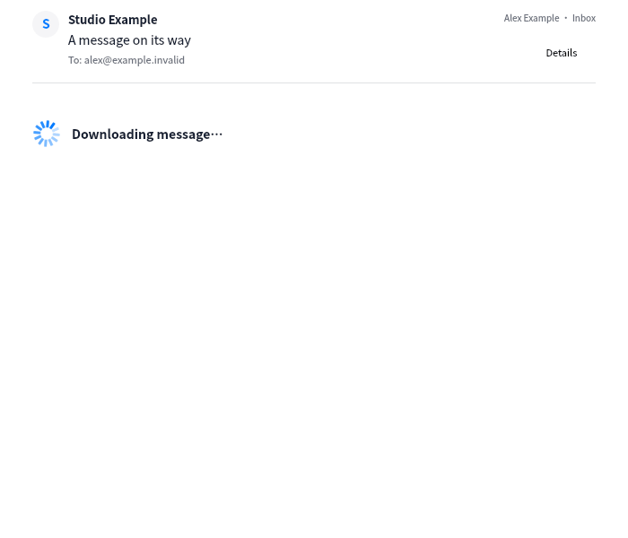

# Animated activity feedback · 2026-11-04

Loading feedback now uses one application-local `MailActivityIndicator` in the reader,
empty mail list, search field, sidebar sync status, account setup and sending state.
The list's static ellipsis is removed. Ordinary scene-item geometry and NumberAnimation
provide explicit motion on both software and OpenGL renderers, without changing the
pinned Kos.Ui dependency or its control sources.

This GIF contains 12 separately captured Qt frames from the VM's software renderer,
using synthetic `.invalid` data. Every adjacent frame was checked to differ. It is a
recording of the running component, not a static screenshot with animation added later.
Playback is encoded at 100 ms per frame and is not a frame-rate benchmark.

Normal mode rotates continuously; reduced-motion mode uses a slower opacity pulse.
Hidden indicators/windows and stopped activity cease animation. Account validation and
sending now have visible activity in addition to their existing text. Buttons retain
the existing material and interaction behavior.

VM software and Xvfb/OpenGL tests passed for actual changing pixels in normal/reduced
motion, pausing while hidden/stopped, and integrated reader/list loading. Captures use
the enclosing views for clipped ScrollView/ListView content: direct subitem captures
can be unchanged and do not establish whether the visible view is animating. Full VM
reader/UI/i18n/catalog checks passed 4/4 in 49.40s. The animated capture test also passed.
No host automated tests, component dependency upgrade, private screenshots or mailbox
writes. The host app was rebuilt/relaunched for the authorized manual inspection.
