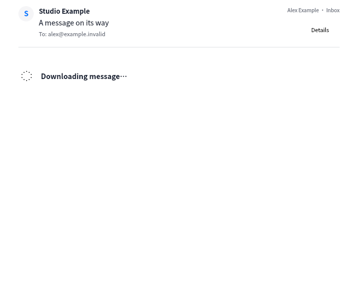

# Reader loading and header continuity · 2026-11-04

Selecting an uncached message previously cleared its presentation while setting the
selected UID. The reader therefore showed an empty avatar/subject/recipient header and
blank body until the entire message arrived. It now presents the selected list summary
immediately, then replaces it with the downloaded content. Missing recipient rows and
unknown headers are hidden rather than presented as empty metadata.

This actual VM capture uses synthetic `.invalid` identities and a controlled pending
message. The download indicator is animated in the application. A separate rendering
indicator covers the local browser's initial document measurement. Failures retain the
known header, show a local error and expose an ordinary Retry button. Legacy cached
content remains visible during its formatting upgrade. Reply/forward are guarded while
an uncached body is pending. Selection generations continue to reject obsolete results,
and previous attachments are cleared before a new selection.

`bodyPending`, `bodyLoading` and `bodyError` belong only to the controller's current
presentation map; they are not persisted as mail content. Opt-in content diagnostics
report only fixed stages and elapsed milliseconds, without mail identifiers, headers,
bodies or credentials. Transfer/protocol parsing and local content preparation can be
compared by stage, but these timings are not an isolated network benchmark.

VM reader/browser, protocol, i18n and catalog checks passed. Final UI/controller rerun
passed 2/2 in 49.14s. New tests cover a suspended body download preserving its summary,
failure and retry, local loading/error visuals and existing stale-selection/attachment
protection. The initial tests needed a populated list-summary fixture and an exposed
window parent; those setup errors were corrected before final acceptance. The screenshot
capture check also passed. No host automated tests or real mail publication; no mailbox
write or SMTP submission. Real body timing/visual acceptance is pending the manual run.

The live diagnostic follow-up recorded body operations of approximately 11.73s and
3.48s, dominated by IMAP connection/authentication and content transfer/protocol parsing.
Local content preparation after fetch took approximately 6–8ms. This does not isolate
browser rendering time or constitute a network benchmark. Each uncached body currently
opens a new IMAP connection, which adds latency; connection reuse is not implemented by
this loading-state change.
