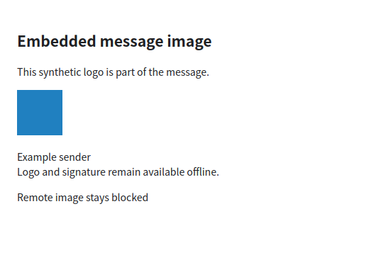

# Embedded message image rendering

VM-only synthetic renderer capture. The image is an application-produced raster data URL, matching the output verified by CID MIME protocol and sanitizer fixtures. The remote image remains a blocked placeholder; the browser test verifies no network hits.

Protocol cases cover nested multipart/related plus alternative bodies, bracketed and percent-encoded IDs, duplicate/missing IDs, invalid bytes, SVG and oversized parts over both TLS modes. Controller regressions cover format-0/1 cache upgrades; core checks preserve remote consent and bound output expansion. No personal mail or provider data is present.
