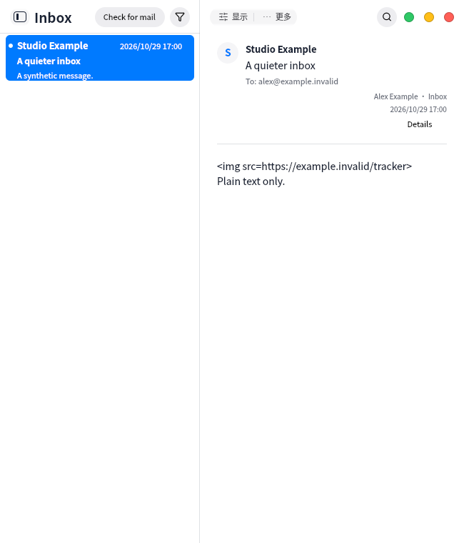

# First receipt and visible mail check

New accounts start fetching automatically. Adding another account preserves the active reader and writes headers to the new account cache. The first-account path waits for queued session password restoration and ignores stale account/generation callbacks.

A labeled Check for mail button now lives above the message list; the completion page also explains Ctrl+R and where connection errors appear. iCloud guidance describes the implemented IMAP/SMTP app-password flow without claiming Apple sign-in or real-provider verification.

VM: full UI/controller/i18n/catalog checks passed 4/4 (82.55s); UI dependency pin and 32 guard tests passed. Targeted first-account/background-cache/no-send and narrow-window/busy-state checks passed. No host execution or real mailbox writes.

