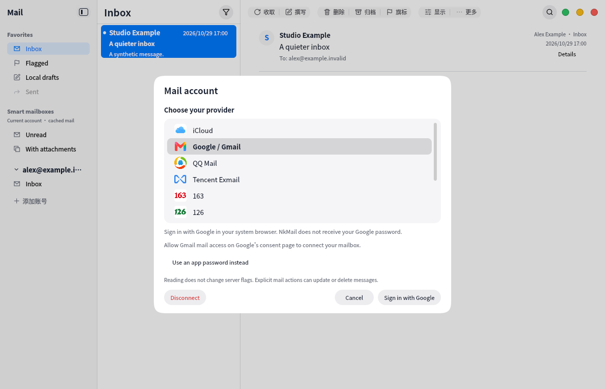

# Google sign-in · 2026-11-04

Google accounts now use the system browser with the publisher's shared Desktop OAuth
client. The user chooses Google and signs in, without entering a client ID, registering
Google Cloud, or giving NkMail their Google password. The dialog uses ordinary material
buttons and does not require an email/password field before opening Google.

This is an actual VM capture of the account dialog with a synthetic configured-project
fixture and `.invalid` mail identities. It proves the rendered UI, not real Google consent
or mailbox compatibility. The fixture opener never contacts Google.

The client implements PKCE, strict loopback callbacks, verified email identity, offline
token refresh/rotation through QtKeychain and Gmail IMAP/SMTP XOAUTH2. Google account
creation succeeds after authorization even when the mail ports are temporarily unreachable.
Pending account saves can be retried without opening a second consent flow.

The VM pinned-source Release build with bundled synthetic project configuration passed
all 10 CTest suites in 86.23s. A large-reader assertion initially observed Chromium's
partially parsed text node; it now waits for the complete text, preserving the 300,000
character expectation. A final protocol/controller/OAuth rerun covers the narrower handling
of mail authentication errors. CI requires OAuth tests and bundles only synthetic JSON.

The project owner has created the real Desktop client and enabled Gmail API; real config
stays outside this public repository. Google currently restricts this project to its test
users. Real user consent, public branding/privacy information and Google's production
verification remain separate acceptance steps. No real mail, credentials, raw logs, project
console screenshots or build products are published here. No external sending or mailbox
mutation was performed.

Consent diagnostics now distinguish missing Gmail mail scope from a missing offline
refresh token. The interface explains that mail access is required, without assuming
Google always shows a checkbox. Existing Google grants can change the consent layout.
A reported generic authorization failure does not establish which permission is missing;
real acceptance remains pending until the separate error or successful retry is observed.

The follow-up UI/i18n/catalog/OAuth checks passed 4/4 in 43.08s. Fixed diagnostic fields
(stage, network enum, HTTP status and allowlisted provider code) help distinguish request
failures without logging URLs, headers, response bodies, account identities or tokens.
