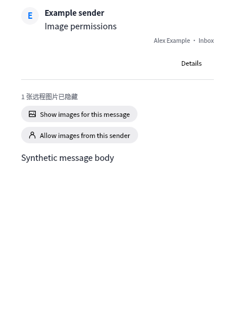

# Persistent remote image permissions

Synthetic reader fixture captured in the validation VM at 400 px width. No real messages, addresses, credentials or provider URLs are included.

The reader offers message-only consent and account-scoped sender consent. Both persist across restarts; sender consent applies to subsequent messages from that exact address. Display options expose the global automatic-loading switch, current-sender toggle and reset action. The global default remains blocked. Permission keys distinguish account, folder, UIDVALIDITY and UID; account removal deletes that account's permissions. Loaded image bytes remain in a bounded memory cache.

Validation includes persistent permission/isolation/revocation tests, synthetic loopback requests across controller restarts, sender/global auto-load, existing retry/network-limit coverage, and QML interaction/width checks. All automated tests and capture run in the VM.

Reader actions use 14 px image/sender glyphs and compact rounded material buttons. The sender action is labelled “允许此发件人显示图片” / “Allow images from this sender”. Display preferences are reached through the right-hand toolbar Display control, or More → Display in a narrow window.
