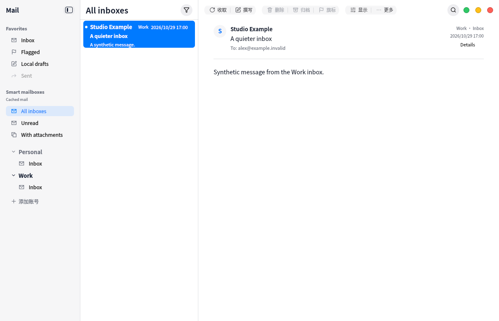

# Multi-account recent inbox synchronization

The unified inbox Refresh action now reads the newest 50 headers from each saved
IMAP/POP account with available credentials. Periodic refresh additionally downloads
inactive-account inbox headers. The existing read-only aggregate, source-account
routing and on-demand body loading remain in place.

InboxSync owns a serial queue independent of foreground browsing. Each result opens
an account-bound cache connection and verifies that the account still exists with
the requested configuration. Account edits/removal, disconnect and foreground
mailbox writes cancel old results. Missing credentials or one failed server do not
stop the remaining accounts. POP reconciliation preserves local flags and deletion
tombstones. Repeated Refresh requests coalesce; the existing progress UI reflects
an active aggregate refresh.

The loaded aggregate window and selected body survive ordinary header refreshes.
UIDVALIDITY changes invalidate the selected body for that source inbox. Tests use
synthetic transports/credentials and cover overlapping identities, account failures,
missing credentials, POP state, edited/deleted accounts, cancellation, pagination
and source switching while a header request is blocked.

Scope: bounded recent headers only, not a full-history mirror or reconciliation of
remote deletions. Older uncached mail remains accessible from source folders. The
aggregate is still read-only; this does not add IDLE or POP notifications. The UI
capture uses synthetic accounts and demonstrates presentation, not a live provider
connection. Runtime validation is performed in the VM only.

Validation: full VM suite 10/10 (115.99s); final progress UI/controller/i18n/catalog 4/4 (65.19s); canonical pin check and 32 dependency guards passed. Synthetic UI capture regression passed and the image was reviewed.

