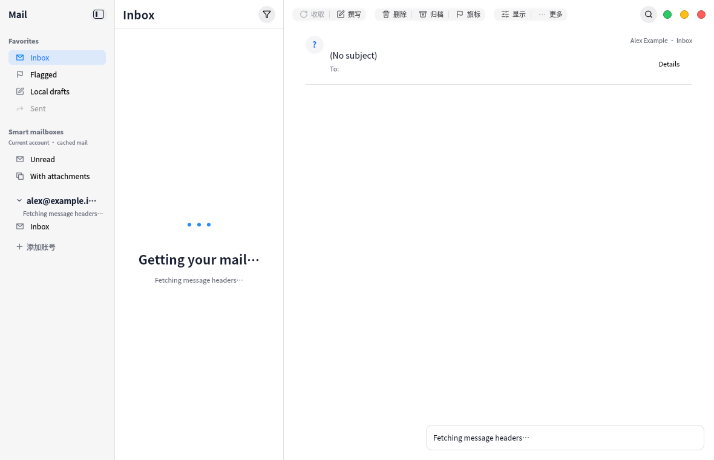

# Bounded batch header retrieval · 2026-11-04

A page previously fetched each message header through a separate IMAP request, up to
50 requests before any page could appear. It now issues one UID FETCH for the bounded
UID search result. The application keeps the original newest-first order even if the
server replies out of order, skips messages that vanish during retrieval, and advances
the pagination window independently of the number of returned messages. EXAMINE,
BODY.PEEK[HEADER], per-literal limits and verified TLS remain in use.

The empty loading view shows the current localized synchronization phase. Optional
`NKMAIL_SYNC_DIAGNOSTICS=1` emits only fixed page-stage names and elapsed milliseconds;
it does not log account IDs, folder names, mail content, headers, credentials or wire
protocol. These diagnostics do not themselves impose a whole-operation deadline.

This is an actual VM capture with synthetic `.invalid` data. It demonstrates loading UI,
not successful real-provider synchronization. The initial live report established that
folders had been cached but no message page had been saved; batch retrieval is an
identified performance improvement, not yet proof of the full cause of that report.

VM pinned-source build succeeded. UI/i18n/catalog/protocol checks passed 4/4 in 66.11s;
controller checks also passed. New TLS and STARTTLS protocol cases assert one bounded
header fetch for sparse UIDs, correct ordering for out-of-order replies, and correct
pagination after a message vanishes. The loading-phase capture test passed separately.
An initial fixture expected singleton IDs without explicit equal range endpoints; it
was corrected to mailio's valid `uid:uid` wire format before final acceptance.

The host build was relaunched only for the authorized manual read-only retry. Automated
checks ran in the VM. No real mail, private logs or machine settings are published, and
no real mailbox write or SMTP submission was performed. The user subsequently confirmed that the Google message list appeared; fixed-stage
diagnostics recorded page completion in approximately 7.9 seconds. This establishes
real header-list retrieval for that run, not message-body reading, token refresh,
restart restoration or sending. The current hosted gate remains separate.
