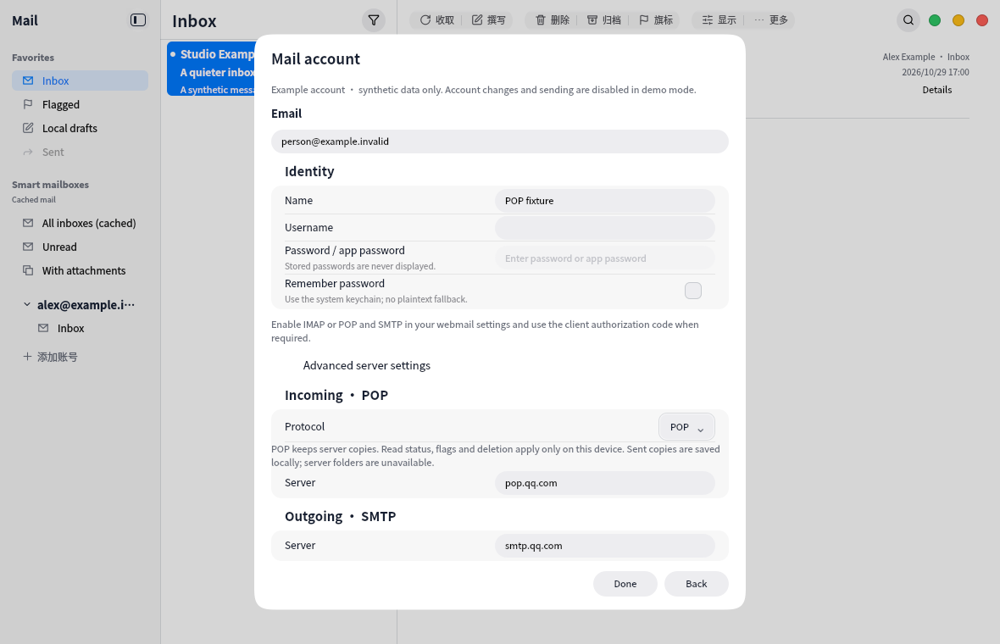

# POP incoming mail

The incoming-protocol selector supports IMAP or POP, with provider defaults and manual endpoints. iCloud offers IMAP only; the unavailable Microsoft/Exchange option has been removed. The capture uses synthetic `.invalid` account data and never connects to a real mailbox.

POP uses mailio TLS/STLS and USER/PASS, requires bounded stable UIDL identities, and uses TOP with bounded RETR fallback. No DELE is issued. Local read/star/delete state persists across restart, and deletion tombstones prevent refresh from restoring locally removed messages. Downloaded content survives server removal; an uncached body may no longer be retrievable. Server folders, moves/archive, remote search and inactive POP account notifications are outside this feature.

SMTP acceptance stores a local Sent copy without IMAP APPEND. Accepted/unknown drafts cannot be automatically resent. Existing IMAP behavior and legacy account defaults remain covered by regression tests.

Validation ran only in the VM: full suite 10/10 (111.88s), followed by final controller/UI/i18n/catalog checks 4/4 (59.91s), canonical UI pin gate and 32 dependency guard tests. Protocol fixtures cover implicit TLS/STLS, UIDL renumbering/duplicates/missing identities, optional TOP, MIME/attachments, dot unstuffing, download limits and certificate rejection before authentication. Screenshot reviewed. Host builds are for user manual use only.
