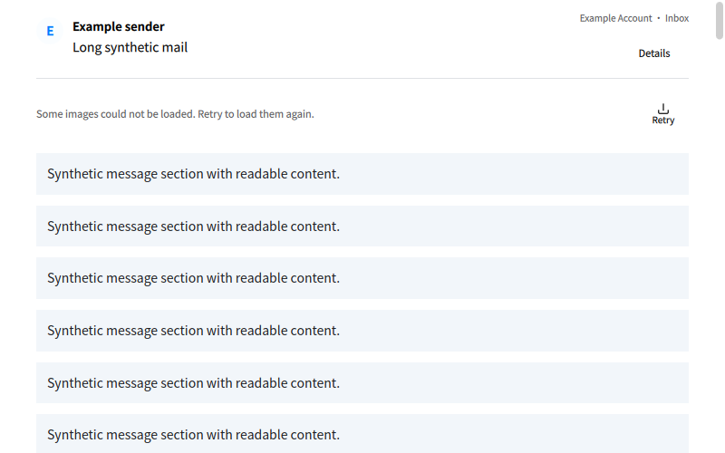

# Reader scrolling and retryable images · 2026-11-04

The reader now has an explicitly sized/anchored vertical scrollbar for overflowing
content. A wheel handler forwards ordinary measured-document wheel/touchpad events to
the reader's scroll surface, because the embedded browser could consume them without
moving that surface. Normal documents hide the redundant native browser bar; capped
12,000px browser surfaces retain internal scrolling for exceptionally long documents.
Height measurement includes the document element and body. The existing surface cap
is not removed by this change.

This is an actual VM capture with synthetic content. The image-failure notice is a
controlled test state, not a screenshot of private mail or a real provider response.

Remote images remain opt-in. Clicking Load images shows animated activity and prevents
duplicate requests. The loader runs at most four downloads concurrently, retaining its
20-URL and 2MiB-per-response limits, adding a 16-million-pixel image bound and a 30-second
active-batch deadline. Requests remain cookie/Referer-free, with verified TLS and no
HTTPS downgrade. Pending batches can still queue behind another active batch.

Failures preserve the original sanitized placeholder URL and add a failure marker,
so the user can retry. Previously a failed request replaced the original URL with a
failure span, preventing a normal retry. Successful images retain sanitized display
styles and become in-memory data URLs. Fixed diagnostics contain only network enum
and HTTP status; no URLs, headers, response bodies or account data are logged.

VM reader/UI/controller/i18n/catalog checks passed 5/5 in 58.17s before the final scrollbar
anchoring/measurement polish. Subsequent reader and full UI checks passed, including
actual wheel input and thumb dragging. A loopback fixture holds four requests before
responding to prove concurrency, fails one, then verifies a retry fetches only that
remaining URL and clears its failure marker. It also checks that cookies and Referer
are absent. UI checks cover activity and failure/retry state.

The user confirmed that scrolling and images worked in the updated host build. This
is acceptance for that manual case, not a guarantee for every remote server: the exact
cause of the earlier external image failure was not captured. No privacy defaults were
relaxed, no real mail was published, and no mailbox write or SMTP send was performed.
