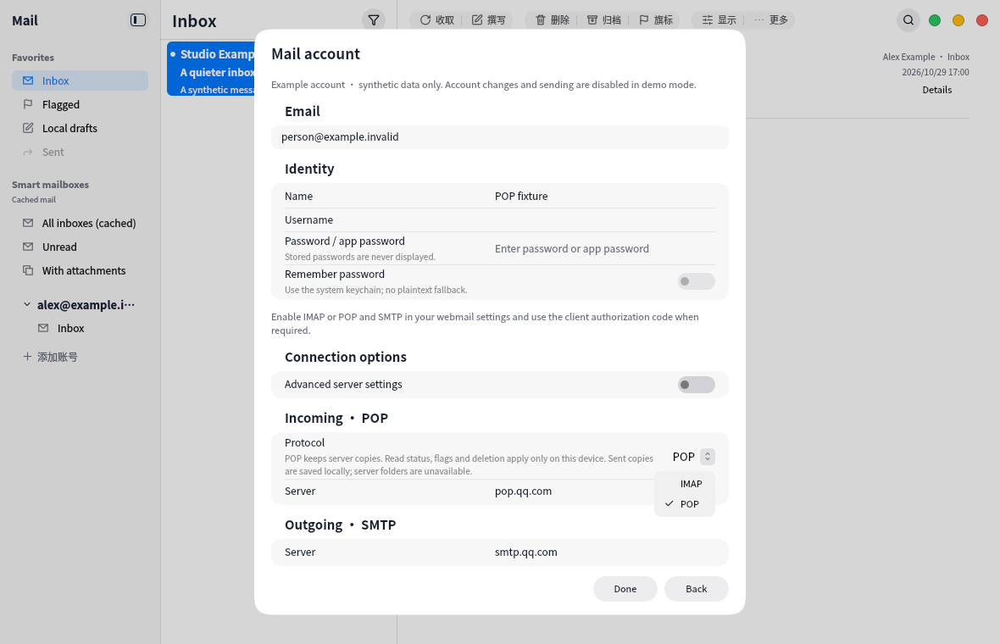
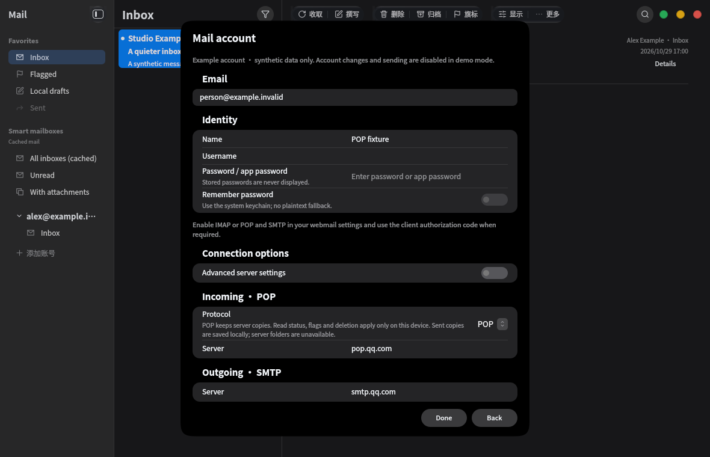

# Account and display settings use the canonical form contract

The pinned Kos.Ui `docs/Settings.md` explicitly requires SettingsTextField and SettingsSwitch for grouped editors, plus the value-only LiquidSelect settings variant. NkMail previously used capsule KosTextFields, KosComboBox and mixed checkbox controls in these contexts. These were application integration errors; the component library and its pin are unchanged.

- Grouped fields now use the shared 24px plain editor without nested backgrounds. Standalone email uses the block-input variant. Groups use 12px spacing and compact non-stacking editor rows.
- The protocol selector uses the canonical 24px value-only up/down trigger, neutral ordinary popup, regular-weight option text, checkmark selection and shared shadow settings.
- Account and display toggles use SettingsSwitch with explicit owner-state updates. The account dialog inherits the canonical background opacity.
- Provider choice rows remain ordinary navigation rows with exclusive radio semantics. Their model derives from the provider catalog, removing a stale hardcoded index left after Microsoft removal.

Synthetic captures and interaction checks ran in the VM only. Tests cover editing, repeated switch state updates, protocol changes, narrow field bounds, image-policy toggles and repeat selection of a provider. No credentials or personal mail are shown. These changes do not alter protocol/storage behavior or the composer's separate formatting-toolbar contract.

Final VM UI/i18n/catalog checks passed 3/3 in 56.22s. The required upstream pin verification is blocked by repeated GitHub API TLS connection failures; the pin is unchanged and no integration PR/check bypass is claimed.
