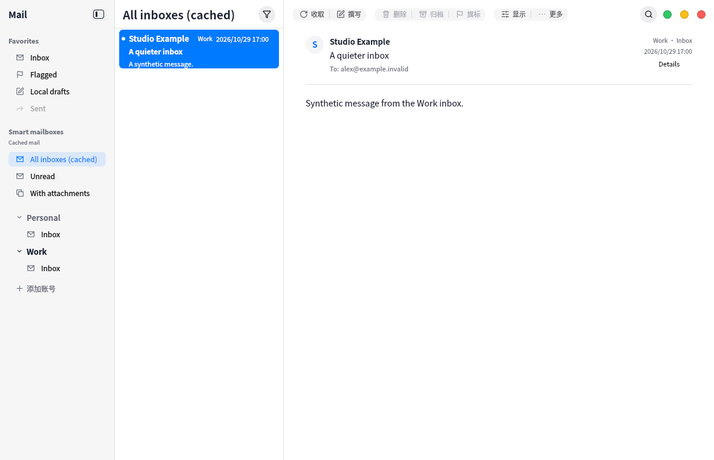

# Cached unified inbox

The smart-mailbox section now includes **All inboxes (cached)**. Rows keep their account, folder, UIDVALIDITY and UID identity; their source account is visible. Opening a row binds the correct account for cached content, credential restoration, body downloads, image permissions and replies. Loaded pages survive source-account changes.

This first aggregate is read-only and uses locally cached inbox headers. Refresh reloads the aggregate cache; it does not synchronize every account remotely. Search and unread filtering apply to cached rows. Opening a message does not mark it read. Use **Open source folder** in the row menu to manage a message in its original account.

Synthetic regressions cover duplicate UIDs across accounts, reorder/update, pagination, stale mailbox epochs, removed accounts, rejected cross-account cache writes, asynchronous credential/body routing and blocked mailbox mutations. UI coverage checks the source badge, navigation, selection and disabled actions. No real mailbox writes or host automated validation.

Validation: full VM suite passed 10/10 (105.87s); canonical UI pin gate and 32 dependency guards passed. The synthetic screenshot was reviewed.
