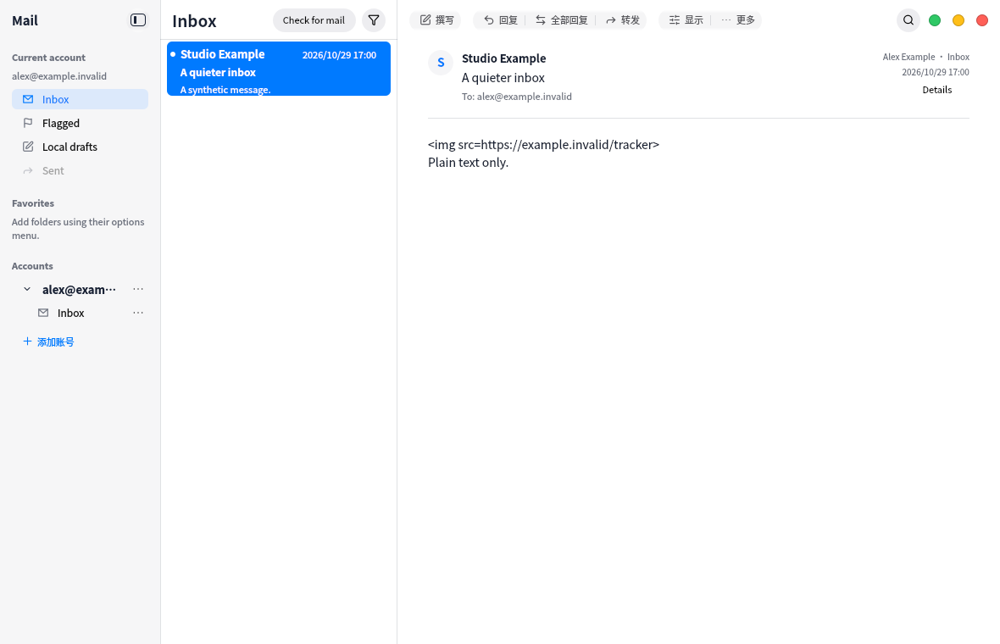

# Mail navigation and action usability

Separate current-account shortcuts from fixed favorites. Show the active address
once above its shortcuts; custom favorites have a second address line and complete
scope tooltips. Account titles expose their full address on hover. Draft counts
use muted text and an explicit draft-count tooltip; unread badges retain blue and
an unread-count tooltip.

Accounts, folders and custom favorites expose a small options action using the
same menus as right click. Keep disclosure separate from account navigation.
Prioritize reply actions over delete/archive actions when space is constrained;
compact reply actions retain labels through accessible names and tooltips.
The list header owns the single direct mail-check action, with active-account
scope in its tooltip and a checking label while busy.

An empty list now displays the available error and a read-only mail-check retry.
Initial receipt failures retry their account-scoped workflow; other errors offer
refresh, never replaying a failed write operation.

Validation runs only in the VM with synthetic mail. Focused menu, header pointer
and sidebar checks passed 5/5 including lifecycle. The first full run found a
popup lookup error in the new test; exposing the account menu through its row
fixed the test lookup. Final VM UI/i18n/catalog suites passed 3/3 in 62.43s.
Canonical dependency gate passed. Host compilation and
preview replacement are for the user's manual inspection only.

