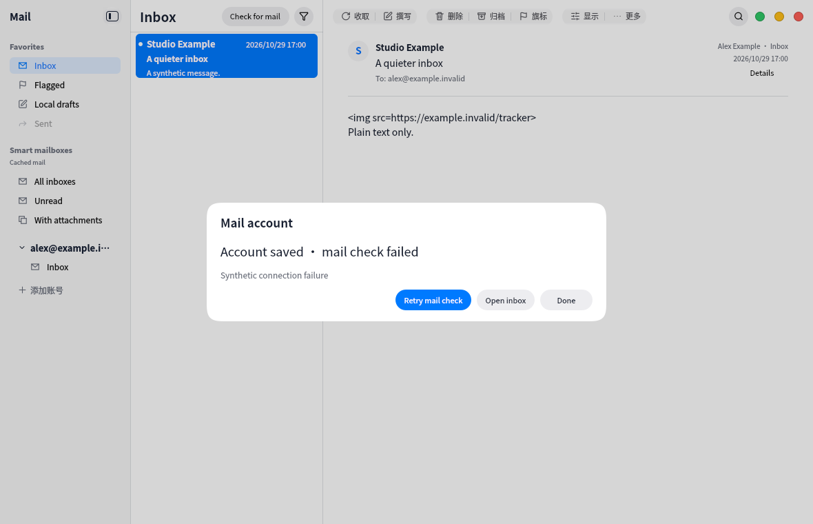
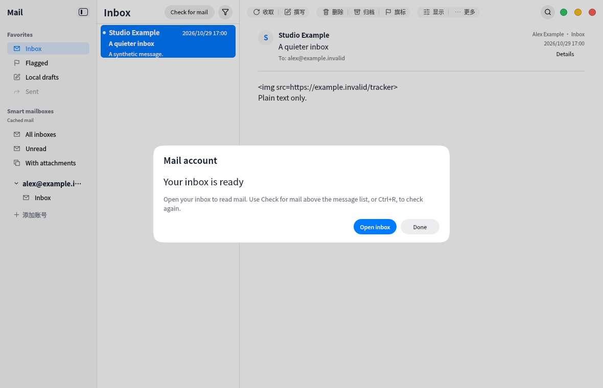
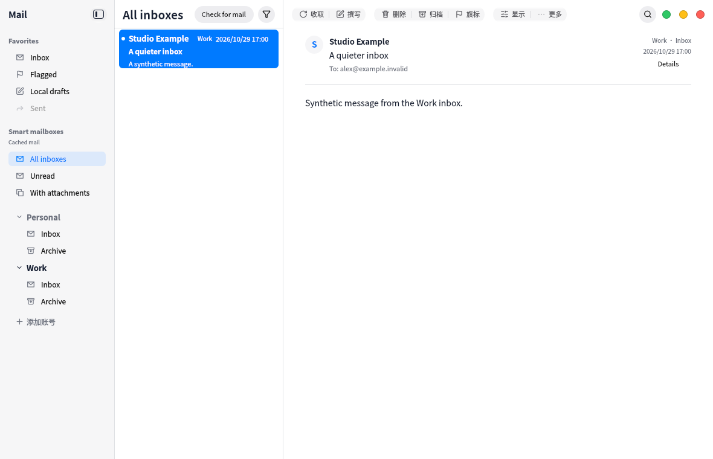

# First receipt and unified inbox actions

Account setup now reports the real first-receipt state rather than only saying the
account was saved. An account-bound queue discovers folders and fetches the newest
50 inbox headers. The completion page shows progress, success or failure with a
primary Retry mail check action and an Open inbox action. Closing the dialog leaves
receipt running; failures can also be retried from the main-window notice. Retry
preserves the account record. Background additions preserve the active reader.
The completion page no longer exposes Disconnect for an unrelated active account,
duplicates errors, or describes all reading as flag-free.

Unified inbox actions partition selected rows by account/folder/UIDVALIDITY and
resolve credentials for each account. They reuse MailboxCommands for protocol
validation and cache writes. Read/flag/delete/archive work across account groups;
archive resolves each source's destination. Move uses one source account's cached
folder list and rejects mixed-account moves. Missing credentials, unavailable
folders and protocol failures report per-account errors while successful groups
remain applied. No write is automatically retried. POP flag/read/delete stay local
and deletion tombstones continue to suppress downloaded headers.

Regression coverage uses only synthetic transports, credentials and loopback
servers. It covers first receipt folder/header failure and retry without duplicate
accounts; equal UIDs in separate accounts; partial read/flag/delete/archive failures;
source-specific move destinations; mixed-account move rejection; POP local deletion;
and body credential restoration concurrent with the automatic read flag. Existing
UIDPLUS, TLS and body/flag race checks remain in place.

The synthetic screenshots demonstrate completion/error actions and unified inbox
presentation, not real-provider acceptance. Runtime testing and capture take place
in the VM. Full VM suite passed 10/10 in 121.98s before the final completion-page
polish; final UI/controller/i18n/catalog checks passed 4/4 in 72.88s. The focused capture run passed 4/4 including lifecycle. Canonical UI pin and 32 dependency guards passed. Final captures were reviewed.

