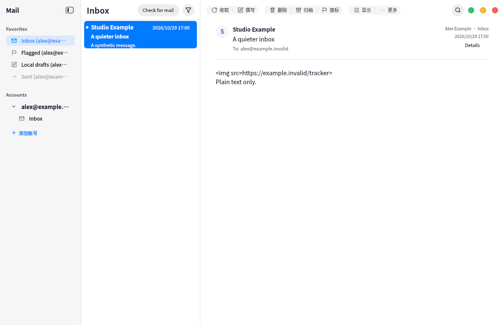

# Sidebar hierarchy and account creation

Favorites and Accounts now use aligned section headings with matching typography.
Expandable account names align with favorite row text; account folders remain one
level further indented. Add account is a left-aligned blue plus-and-text action without a filled
background, using the shared control for keyboard/accessibility behavior.

VM UI/i18n/catalog suites passed 3/3 in 59.98s. Follow-up hierarchy/disclosure
checks passed 4/4 including lifecycle; final caption/capture check passed 3/3.
The initial capture revealed the shared action's icon-only content when iconName
was supplied; the final mail-specific content layout displays icon and text.
Canonical UI pin check passed. This screenshot is synthetic; no real mailbox or
user screenshot is included. Host build/replacement is for manual use only.

User-requested plain blue action follow-up: VM sidebar and empty-profile account
entry checks passed (4/4 including lifecycle); synthetic capture refreshed.
