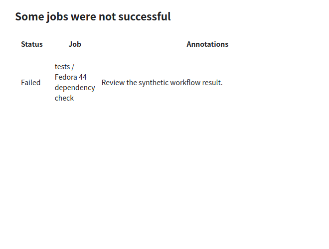
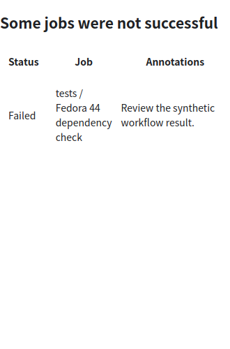

# Preserve intrinsic table column widths

A synthetic notification with 1% preferred status/job columns reproduced the
reported vertical-letter layout. The application envelope's inherited
`overflow-wrap:anywhere` lowers min-content widths to individual glyphs, allowing
auto-layout tables to compress these columns excessively. The regression failed
on the old renderer and passed after switching the default to `break-word`.

Keep sender CSS and table layout intact. Long ordinary prose still wraps, while
intrinsically wide tables now expose the native horizontal scrollbar instead of
being clipped behind hidden scrollbars. Application-owned isolated measurement
tracks width as well as height and resets dimensions when the message changes.
No sanitizer permissions, remote-image policy, script policy or body cache format
changes are required; cached HTML receives the new envelope when reopened.

VM reader/core suites passed 2/2 (5.91s). Coverage checks intact header words at
660px and 330px, bounded table height, long prose, horizontal reachability of the
last column, and scrollbar reset for a replacement message. Existing isolation and
restore regressions also passed. Synthetic wide/narrow captures were reviewed.
The canonical UI dependency gate passed. The user's original mail and screenshot
are not included in these public artifacts.

