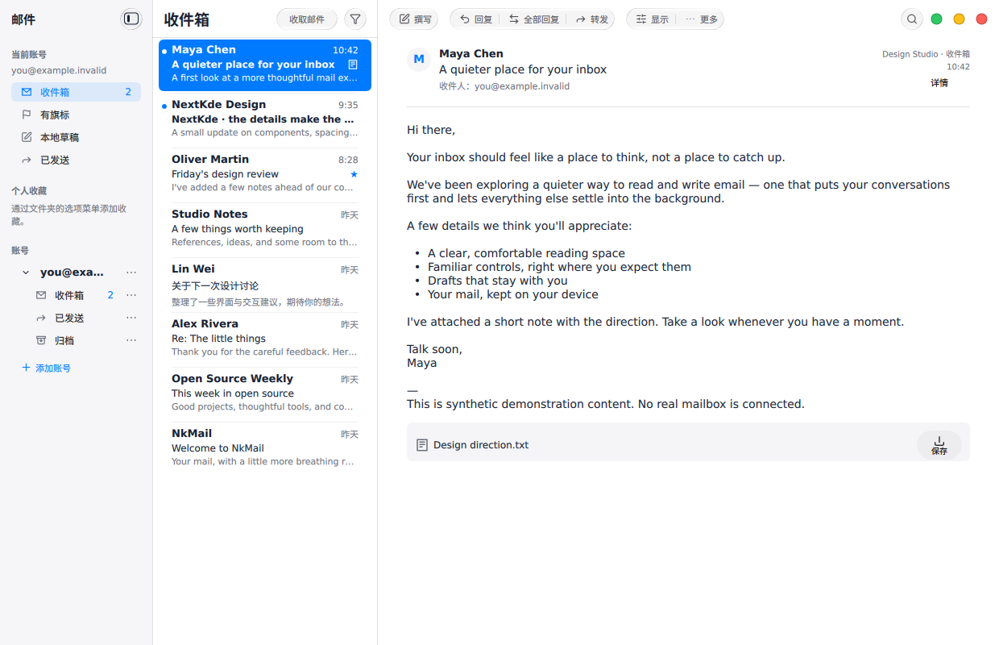
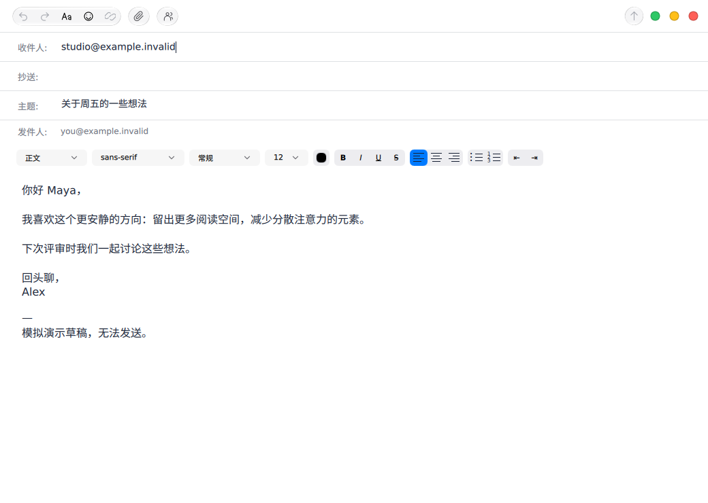
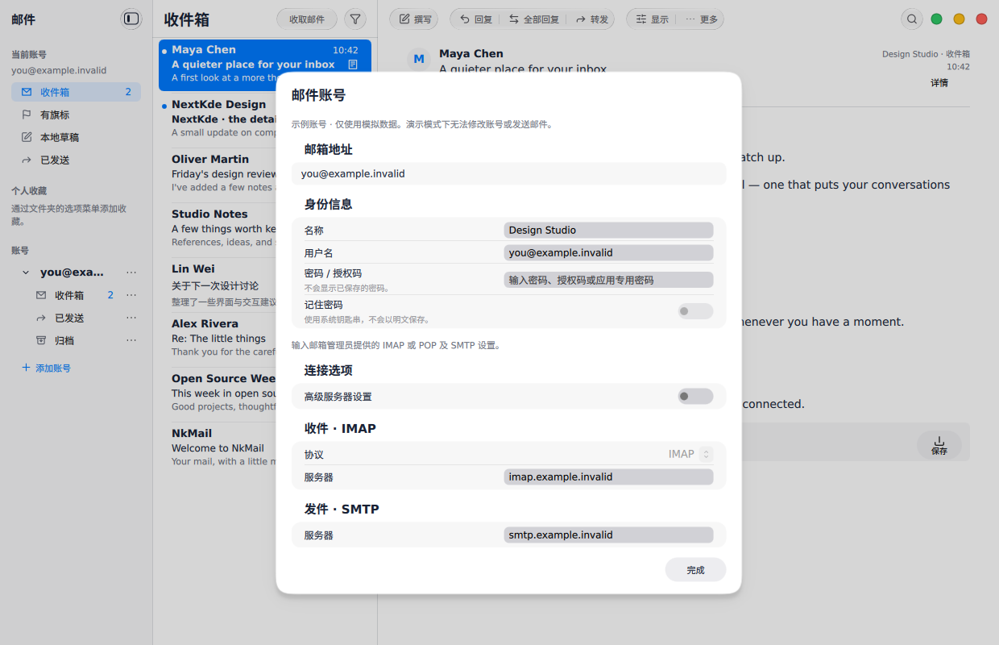

# Flatpak acceptance · 2026-11-10

Accepted application source: `4ff223d6453af784f310426783f1df6577f7dcc1`, integrated
through [PR #33](https://github.com/NextKde/NkMail/pull/33). Application ID:
`org.nextkde.NkMail`, x86_64, stable branch. Shared runtime:
`org.kde.Platform//6.11`; WebEngine comes from the matching BaseApp. The pinned
Kos.Ui source is unchanged. See [packaging and permissions](../../../packaging/flatpak/README.md).

[Release-gate and Arch package](https://github.com/NextKde/NkMail/actions/runs/42646453656)
passed: 32 dependency checks and all 11 application suites (98.23 seconds).
[Flatpak acceptance](https://github.com/NextKde/NkMail/actions/runs/42646453663)
passed exact-bundle installation, three offline synthetic previews, normal-launch
single-instance activation, reinstall and data-preserving uninstall.

The downloaded bundle's hash, exact metadata bytes, installed size, runtime and
single-instance ownership were independently verified. Both embedded origin URL
and runtime-repository URL are absent. Package size: 134,776,112 bytes; installed
size: 511,931,904 bytes, excluding the shared runtime.

- Bundle SHA-256: `49ebe362ae8acd62ad6fdd38303d77b2bf4aadddedf12dc781430af0274bfd14`
- OSTree commit: `d481ce8951b85e1e0b2252ae4daff5301d514687950bd2be30f787b94dc89823`
- Distribution: [NkMail v0.1.0](https://github.com/NextKde/NkMail/releases/tag/v0.1.0),
  with schema-2 `flatpak-release.json`, matching sources and build inputs.

The images below are from this accepted installed bundle and were visually
inspected. All mail/address data is synthetic (`.invalid`); network access was
removed during previews. No real mailbox or credential was used. Xvfb rendering
does not establish compositor-specific visual acceptance or interactive desktop
keyring/file-dialog/tray behavior. There is no earlier NkMail Flatpak for a
cross-version upgrade test. Google OAuth is not configured in this package.

Earlier candidates were rejected for in-source mailio builds, an unsupported
same-commit reinstall test, and a duplicated D-Bus `talk` permission overriding
`own`. The final producer verifies exported ownership and the normal-launch test
covers activation. The earlier rejected candidate is not a release asset.

appCatalog submission and signed-catalog publication are separate from the app
Release. The user will perform the catalog signing/publication.

