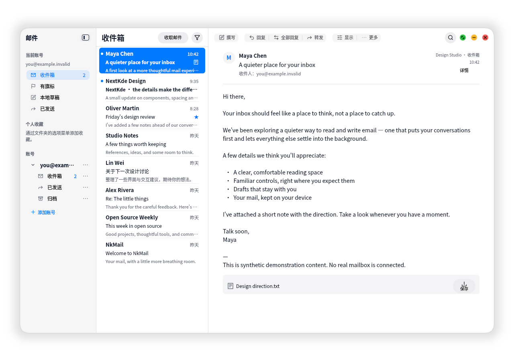
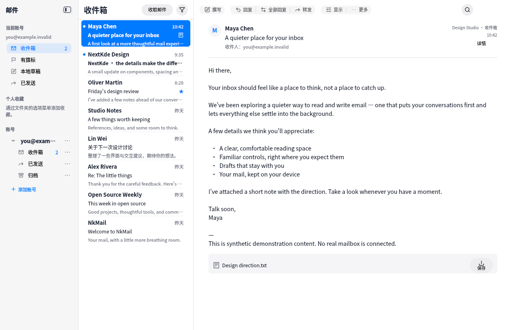
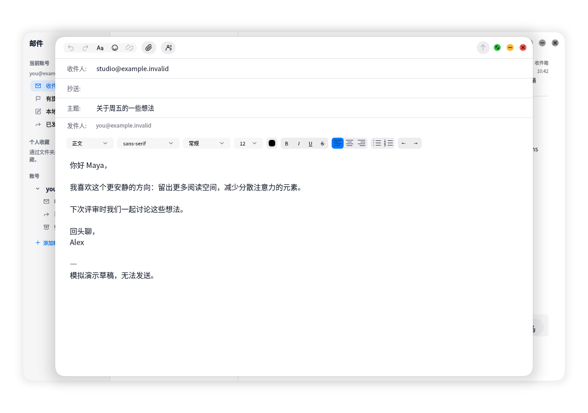
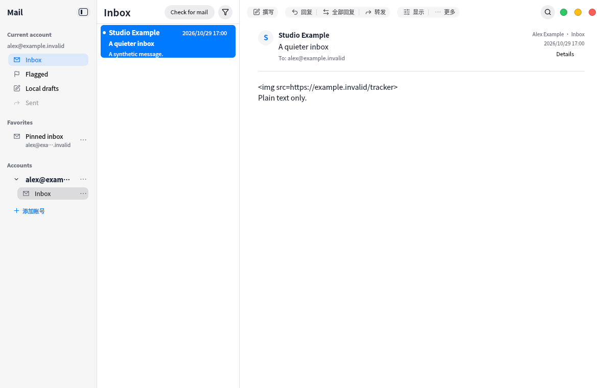
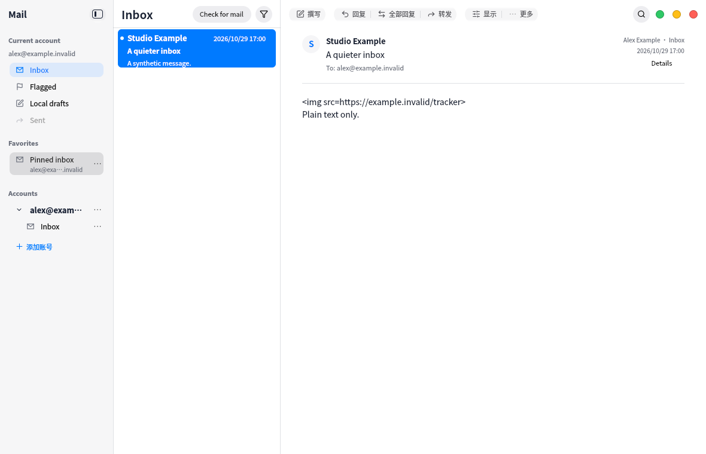
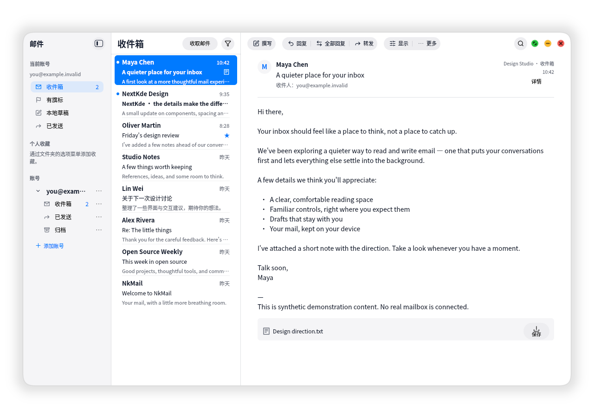
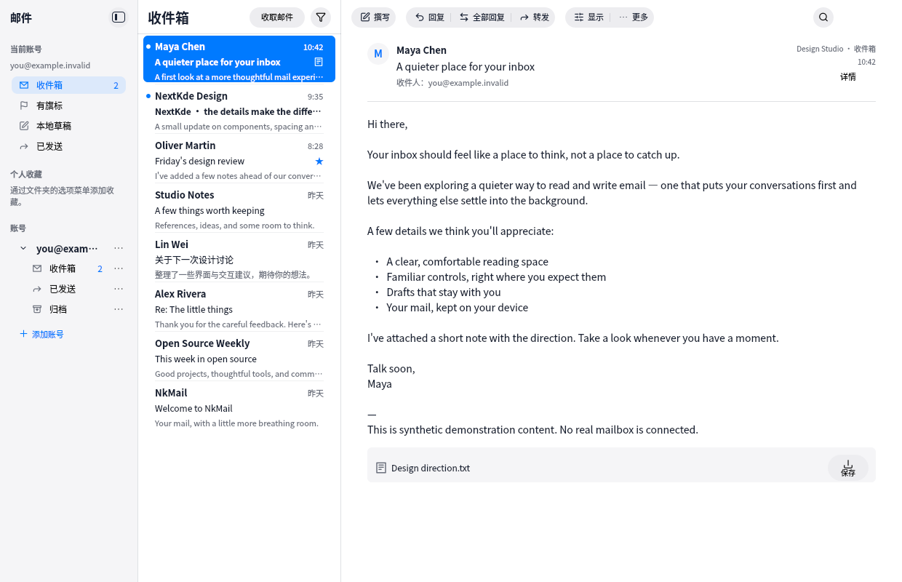
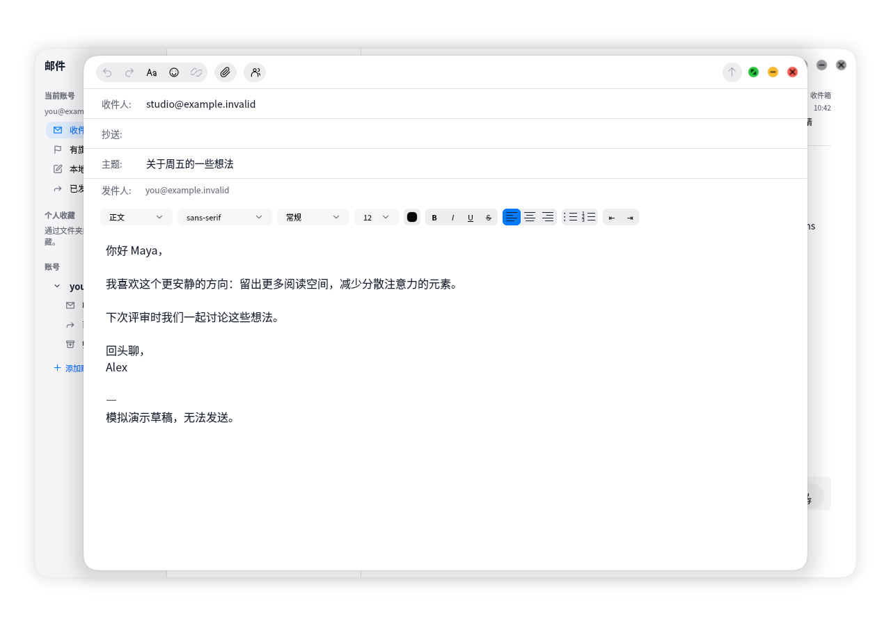

# KWin-owned controls and sidebar spacing

The released 0.1.0 Flatpak did not contain `Kos.SurfaceShape`. Its optional
`NativeWindowControls.qml` import consequently failed and the client kept
painting fallback traffic lights. X11 screenshots and mocked ownership tests
had not covered that missing integration.

The 0.1.1 package builds the canonical protocol module from NextKde/NextKde
`d7b34a8e8b37a9fb7605333f10d02f7b16e70743` against the same KDE 6.11 SDK/runtime.
No host Qt/plugin binary or broad filesystem access is used. KWin receives the
button rectangles; once it acknowledges takeover, client controls are transparent
and disabled while the reserved geometry remains. Both inbox and composer use
this contract.

Every Flatpak synthetic screenshot now requires successful module loading. An
additional review-mode gate requires actual compositor acknowledgement and
hidden/disabled client controls. It selects controls by their QQuickWindow,
since the inbox QObject tree also owns an initially hidden composer.

## VM evidence

- Clean native build using the unchanged canonical Kos.Ui pin; dependency gate
  and all 32 guard tests passed. All 11 application suites passed in 132.70 s.
- Real protocol v2 acceptance passed for both inbox and composer after correcting
  the review check's hidden-window lookup. A missing module and a compositor-less
  offscreen session are both rejected, without creating an accepted capture.
- Native acceptance uses Qt 6.10.2 and an isolated nested KWin 6.6.6 with the pinned
  canonical bridge. The running desktop was not replaced/restarted. Spectacle
  captures the isolated compositor with its normal permissions and desktop menu
  metadata; no screenshot permission checks were disabled.
- The application-only image contains no traffic lights; the compositor image
  does. Stable composer capture confirms its controls and window shape belong to
  KWin. These are synthetic `.invalid` fixtures only, without real mail access.
- Sidebar regression covers both one-line folders and two-line favorites. Icons
  and counts follow the title line; hover and selection share 2 px insets while
  preserving the complete hit target. Focused capture test passed 3/3.
- Exact Flatpak acceptance completed on 2026-11-11: accepted source
  `34fb7490f84cecf308afcf2571f319187748b36e`; release-gate/Arch run
  [42846541027](https://github.com/NextKde/NkMail/actions/runs/42846541027)
  and package/lifecycle run
  [42846541152](https://github.com/NextKde/NkMail/actions/runs/42846541152)
  both passed. The installed commit matched the release plan. Inbox and composer
  passed real module loading, KWin ownership, hidden/disabled client controls and
  stable compositor captures with the exact package, Wayland only and no network.
  The package was uninstalled afterward with data retained.
- Bundle SHA-256:
  `dbd3094e0baf91b99220bb679bc086002d9f11bf5c579bbd6c8c2c5527b32739`;
  135,039,568 bytes; installed size 512,119,754 bytes; OSTree commit
  `5a83578f04d817358ec9f5d2b638aba5f9afc0755fe4ba008cd9f635edb8177b`.
  Shared runtime remains `org.kde.Platform/x86_64/6.11`.
- Publication follows protected PR #38 integration. The existing appCatalog entry
  resolves the latest stable Release; no catalog key or entry change is needed.

## Exact Flatpak under KWin

